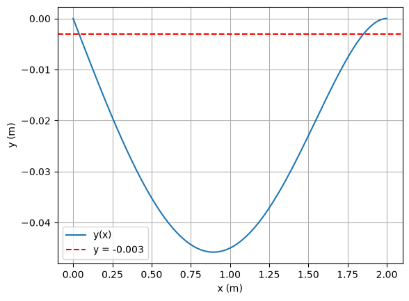

# Ejercicios 4 y 5 — Métodos Numéricos

## Ejercicio 4

```python
import math
import numpy as np
import pandas as pd
import matplotlib.pyplot as plt
```

```python
def Newton(f, df, x0, tol, maxiter):
    iters = 0
    error = tol+1

    while error > tol and iters <= maxiter:
        x = x0-f(x0)/df(x0)
        error = math.fabs(x-x0)
        iters = iters+1
        x0 = x
    return [x, iters, error]
```

```python
def NewtonTabla(f, df, x0, tol, maxiter):
    iters = 0
    error = tol + 1
    lista_e = []
    lista_x = []

    while error > tol and iters < maxiter:
        x = x0 - f(x0) / df(x0)
        error = math.fabs(x - x0)
        iters = iters + 1

        lista_e.append(error)
        lista_x.append(x)
        x0 = x

    pd.set_option('display.precision', 10)
    Tabla = pd.DataFrame({"x": lista_x, "Errores": lista_e})
    Tabla.index += 1  # Ajusta el índice para que las iteraciones empiecen en 1
    Tabla.index.name = "Iteración"

    return Tabla
```

```python
# Ejercicio 4
# Deflexion de la viga: y(x) = w0/(120*E*I*L) * (-x^5 + 2L^2 x^3 - L^4 x)
# Se busca la posicion x donde y(x) = -0.003, es decir y(x) + 0.003 = 0
# L = 2, w0 = 12x10^7, E = 2x10^11, I = 5x10^-4 y tolerancia 10^-6

#Datos del problema
L = 2
w0 = 12e7
E = 2e11
I = 5e-4
c = w0/(120*E*I*L)     # c = 0.005

#La deflexion de la viga
y = lambda x: c*(-x**5 + 2*L**2*x**3 - L**4*x)

#Introducir la funcion
f = lambda x: c*(-x**5 + 2*L**2*x**3 - L**4*x) + 0.003

#la derivada de la funcion
df = lambda x: c*(-5*x**4 + 6*L**2*x**2 - L**4)
```

```python
#Grafica de la viga para elegir la estimacion inicial
xs = np.linspace(0, L, 400)
plt.plot(xs, [y(t) for t in xs], label="y(x)")
plt.axhline(-0.003, color="r", ls="--", label="y = -0.003")
plt.xlabel("x (m)")
plt.ylabel("y (m)")
plt.grid()
plt.legend()
plt.show()
```

**Salida:**



```python
#Primera solucion: cerca del apoyo izquierdo

x0 = 0.5
tol = 1e-6
maxiter = 30

#obtenemos los resultados de la funcion Newton

x,iters,error = Newton(f,df,x0,tol,maxiter)
```

```python
print(" La solucion de la ecuacion es: ", x)
print(" El numero de iteraciones fue: ", iters)
print(" El error fue: ", error)
```

**Salida:**

```text
 La solucion de la ecuacion es:  0.03752641830165473
 El numero de iteraciones fue:  4
 El error fue:  4.5647079231769805e-07
```

```python
NewtonTabla(f,df,x0,tol,maxiter)
```

**Salida:**

| Iteración | x | Errores |
|---:|---:|---:|
| 1 | -0.1236363636 | 0.6236363636 |
| 2 | 0.0403038583 | 0.1639402220 |
| 3 | 0.0375259618 | 0.0027778965 |
| 4 | 0.0375264183 | 0.0000004565 |

```python
#Segunda solucion: cerca del apoyo derecho

x0 = 1.5
tol = 1e-6
maxiter = 30

#obtenemos los resultados de la funcion Newton

x,iters,error = Newton(f,df,x0,tol,maxiter)
```

```python
print(" La solucion de la ecuacion es: ", x)
print(" El numero de iteraciones fue: ", iters)
print(" El error fue: ", error)
```

**Salida:**

```text
 La solucion de la ecuacion es:  1.8522559531557519
 El numero de iteraciones fue:  5
 El error fue:  8.909324389350104e-10
```

```python
NewtonTabla(f,df,x0,tol,maxiter)
```

**Salida:**

| Iteración | x | Errores |
|---:|---:|---:|
| 1 | 1.8147783251 | 0.3147783251 |
| 2 | 1.8495196960 | 0.0347413709 |
| 3 | 1.8522372613 | 0.0027175654 |
| 4 | 1.8522559523 | 0.0000186909 |
| 5 | 1.8522559532 | 0.0000000009 |

---

## Ejercicio 5. (*)

Se define el método **MXY** mediante la siguiente expresión:

$$
y_k = x_k - \frac{2}{3}\frac{f(x_k)}{f'(x_k)}
$$

$$
x_{k+1} = x_k - \frac{f(x_k)}{f'(y_k)} \cdot \frac{5f'(y_k) - f'(x_k)}{4f'(y_k)}

$$

### a) (1.0 pts)

Programar el método del **MXY** en Python.

```python
import math

def MXY(f, df, x0, tol, maxiter):
    iters = 0
    error = tol + 1

    while error > tol and iters <= maxiter:
        df_x0 = df(x0)
        if df_x0 == 0 or math.isnan(df_x0):
            print("Error: Derivada nula o no válida en x0")
            return [x0, iters, error]

        y = x0 - (2 / 3) * (f(x0) / df_x0)
        
        df_y = df(y)
        if df_y == 0 or math.isnan(df_y):
            print("Error: Derivada nula o no válida en y")
            return [x0, iters, error]

        x = x0 - (f(x0) / df_y) * ((5 * df_y - df_x0) / (4 * df_y))
        
        if math.isnan(x) or math.isinf(x):
            print("El método divergió (se obtuvo NaN o Inf)")
            return [x0, iters, error]

        error = math.fabs(x - x0)
        iters += 1
        x0 = x

    return [x, iters, error]
```

### b) (1.0 pts)

Utilizar el método anterior para resolver la ecuación:

$$
e^x\cos(x) - x^3\sin(x) - 1 = 0
$$

usando:

- Estimación inicial: $x_0 = 3$
- Tolerancia: $10^{-7}$

```python
f = lambda x: math.exp(x) * math.cos(x) - x**3 * math.sin(x) - 1
df = lambda x: (math.exp(x) * (math.cos(x) - math.sin(x)) - (x**2) * (3 * math.sin(x) + x * math.cos(x)))

x0 = 3
tol = 1e-7
maxiter = 30

x, iters, error = MXY(f, df, x0, tol, maxiter)

print(f"La solución a la ecuación de x = {x}")
print(f"Las iteraciones realizadas fueron {iters}")
print(f"El error que se tuvo fue de {error}")
```

**Salida:**

```text
La solución a la ecuación de x = 3.0
Las iteraciones realizadas fueron 1
El error que se tuvo fue de 0.0
```

Comparar los resultados con los métodos de **Newton, Traub y Ostrowski**.

```python
def Newton(f, df, x0, tol, maxiter):
    iters = 0
    error = tol+1

    while error > tol and iters <= maxiter:
        x = x0-f(x0)/df(x0)
        error = math.fabs(x-x0)
        iters = iters+1
        x0 = x
    return [x, iters, error]
```

```python
def Traub(f,df,x0,tol,maxiter):
    iters = 0
    error = tol + 1

    while iters <= maxiter and error > tol:
        y = x0-f(x0)/df(x0)
        x = y-f(y)/df(x0)
        error = math.fabs(x-x0)
        iters += 1
        x0 = x
    return [x,iters, error]
```

```python
import numpy as np

def Ostrowski(f,df,x0,tol,maxiter):
    iters = 0
    error = tol+1
    error_x = list()

    while error>tol and iters<=maxiter:
        y = x0-f(x0)/df(x0)
        x = y-f(x0)/(f(x0)-2*f(y))*f(y)/df(x0)
        error = math.fabs(x-x0)
        error_x.append(error)
        iters = iters+1
        x0 = x

    error_x = np.array(error_x)
    eps = 1e-16
    error_x_safe = np.maximum(error_x, eps)
    ACOC = np.log(error_x_safe[2:]/error_x_safe[1:-1])/np.log(error_x_safe[1:-1]/error_x_safe[0:-2])
    return [x,iters,error,ACOC]
```

```python
x, iters, error = Newton(f, df, x0, tol, maxiter)

print("=====Newton=====")
print(f"La solución obtenida fue {x}")
print(f"La cantidad de iteracione realizadas fueron {iters}")
print(f"El error que se obtuvo fue de {error}")
```

**Salida:**

```text
=====Newton=====
La solución obtenida fue 124.09290981679683
La cantidad de iteracione realizadas fueron 5
El error que se obtuvo fue de 5.3943338684803166e-08
```

```python
x, iters, error = Traub(f, df, x0, tol, maxiter)

print("=====Traub=====")
print(f"La solución obtenida fue {x}")
print(f"La cantidad de iteracione realizadas fueron {iters}")
print(f"El error que se obtuvo fue de {error}")
```

**Salida:**

```text
=====Traub=====
La solución obtenida fue -2.6713743274964937e+55
La cantidad de iteracione realizadas fueron 2
El error que se obtuvo fue de 0.0
```

```python
x, iters, error, ACOC = Ostrowski(f, df, x0, tol, maxiter)

print("=====Ostrowski=====")
print(f"La solución obtenida fue {x}")
print(f"La cantidad de iteracione realizadas fueron {iters}")
print(f"El error que se obtuvo fue de {error}")
```

**Salida:**

```text
=====Ostrowski=====
La solución obtenida fue 64.40264939859077
La cantidad de iteracione realizadas fueron 4
El error que se obtuvo fue de 0.0
```

### Comparación de resultados

| Método | Resultado | Iteraciones | Error |
|---|---|---|---|
| MXY | $3.0$ | 1 | $0$ |
| Newton | $124.0929098168$ | 5 | $5.39\times10^{-8}$ |
| Traub | $-2.67\times10^{55}$ | 2 | $0$ |
| Ostrowski | $64.4026493986$ | 4 | $0$ |

- **MXY:** se queda en $x = 3$ con error $0$, pero $f(3) \approx -24.69$, por lo que no es una raíz. El punto $y_0$ salta a $85.09$, donde $f'(y_0) \approx -6.3\times10^{36}$; la corrección resulta tan pequeña que $x_1 = x_0$ y el criterio $|x_{k+1} - x_k|$ da una falsa convergencia.
- **Traub:** diverge a $-2.67\times10^{55}$; el error $0$ solo indica que el valor ya no cambia en aritmética de punto flotante.
- **Newton y Ostrowski:** convergen a raíces reales de la ecuación, pero muy alejadas de la estimación inicial.

**Conclusión:** $x_0 = 3$ es una mala estimación inicial para los cuatro métodos, porque está junto a un punto crítico de $f$: $f'(x) = 0$ en $x \approx 2.9959$ y $f'(3) \approx 0.20$. Al dividir entre una derivada casi nula, el primer paso es enorme ($f(3)/f'(3) \approx -123$) y ningún método alcanza la raíz más cercana, $x \approx 3.8433762366$.
